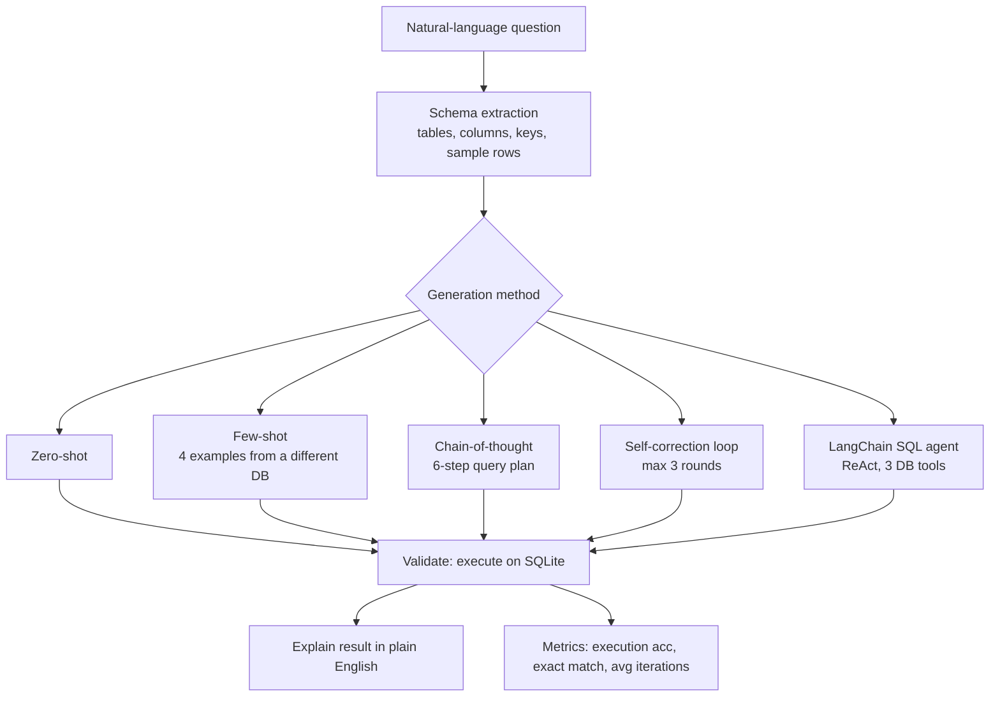

# Architecture

## Components

| Component | Purpose |
|---|---|
| Schema helper | Builds a compact schema prompt for the selected Spider database |
| Generator | One shared model (`openai/gpt-oss-120b` on Groq, temperature 0) with three prompt styles |
| Self-correction chain | Runs the SQL, feeds back errors / empty results / first 5 rows, asks the model for a fix; up to 3 rounds |
| SQL agent | LangChain `create_agent` with `SQLDatabaseToolkit` tools: list tables, read schema, run query |
| Evaluator | Execution accuracy (column-order tolerant, row order only if the gold query has ORDER BY), normalised exact match, average correction iterations |
| Interface | Gradio app: pick a database, ask a question, see the SQL, execution status and a plain-English explanation |

## Design decisions

- **Same model for every method**, so differences come from the method, not the model.
- **Few-shot examples come from a different database** to avoid leaking answers.
- **Shared rules** in every prompt: no `SELECT *`, no `ORDER BY`/`LIMIT` unless asked.
- **Resumable loops** that save after every question, because of free-tier rate limits.
- **Read-only execution** of generated SQL.
